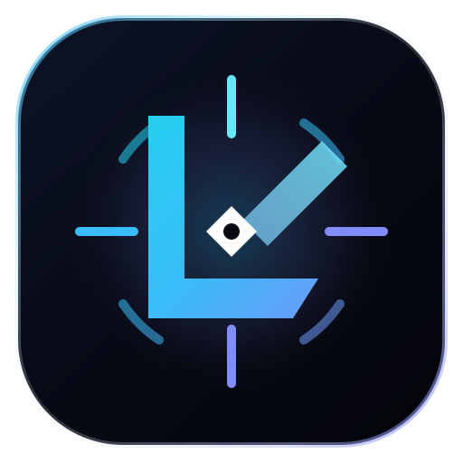
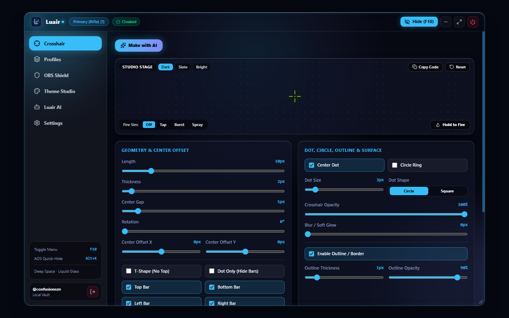
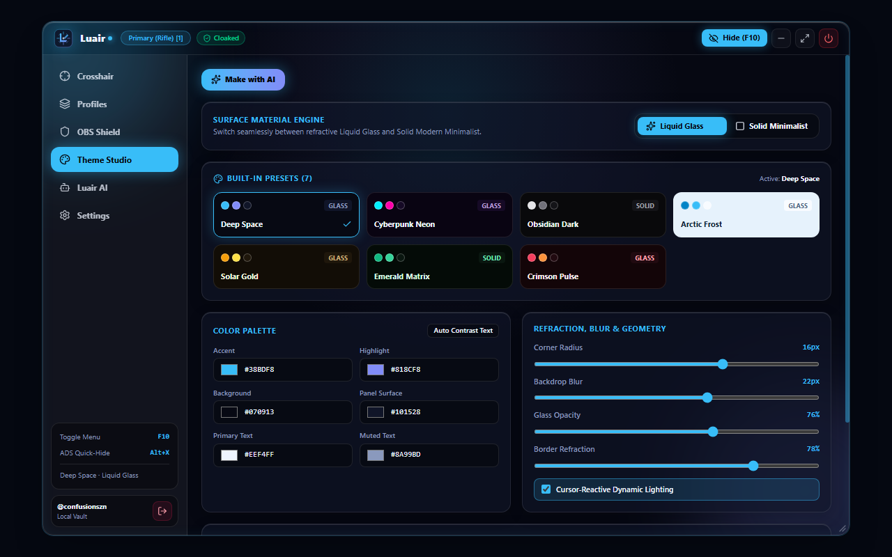
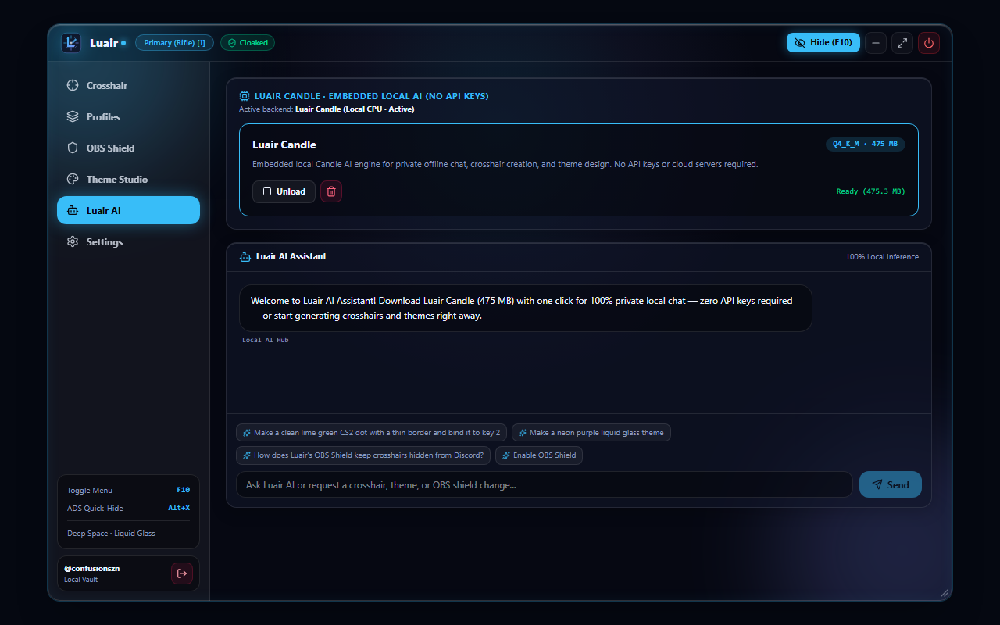
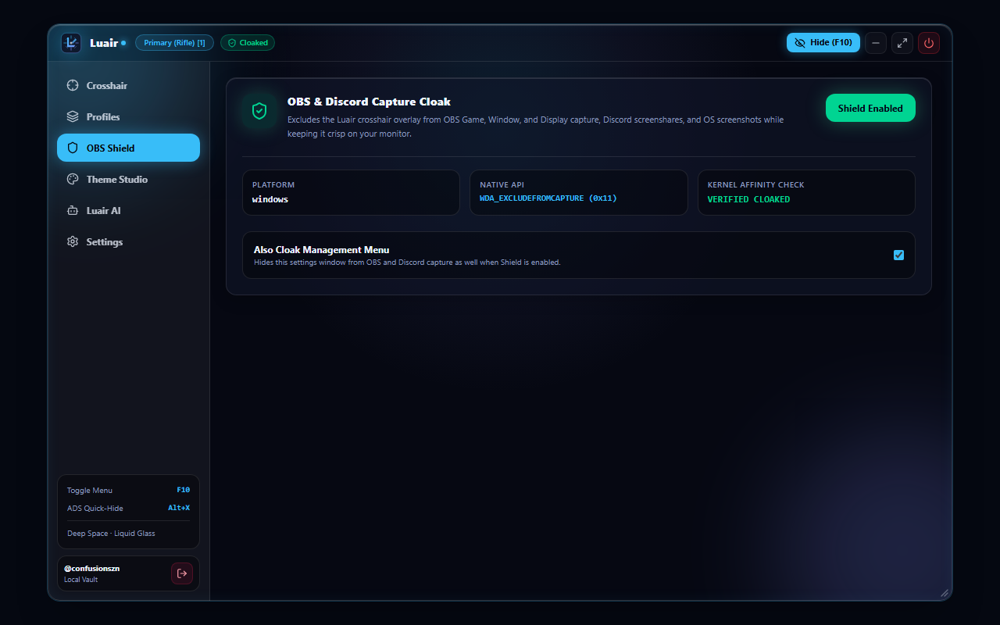

<div align="center">
  
  <h1>Luair</h1>
  <p>
    <strong>Open-Source, Ultra-Lightweight Native Desktop Crosshair Overlay</strong>
  </p>
  <p>
    Built from the ground up with <strong>Rust + Tauri v2 + React 19 + Candle Local AI</strong>.<br />
    Zero game process hooking. Zero external servers. Zero key gates.
  </p>

  <p>
    <a href="./LICENSE"></a>
    
    
    
    
  </p>
</div>

---

## Architecture Highlights

Luair v2 is engineered strictly as an **independent desktop overlay** combining a transparent click-through hardware-composited canvas (`overlay`) with a frameless, resizable management studio (`menu`). It never touches game memory, never injects into game binaries, and keeps every account, preset, and AI prompt private on your machine.

---

## Feature Overview

| Category | Capabilities |
| --- | --- |
| **Native Overlay Engine** | Dual Tauri v2 windows (`overlay` click-through always-on-top canvas + `menu` resizable Liquid Glass UI), DirectX/GDI DWM transparency on Windows, X11 & Wayland virtual workspace persistence on Linux, and macOS Spaces support. |
| **OBS & Discord Capture Cloak** | Native capture exclusion using Win32 `SetWindowDisplayAffinity(WDA_EXCLUDEFROMCAPTURE)` on Windows, `NSWindowSharingNone` on macOS, and Wayland/X11 best-effort protection on Linux, with independent cloak control for the settings menu. |
| **Non-Blocking Global Hotkeys** | Low-level `rdev` pass-through keyboard & mouse button listeners (`1`–`9`, combos like `Ctrl+Shift+X`, `Mouse4`, `Mouse5`, etc.) switch crosshair slots or quick-hide on ADS without stealing focus or blocking in-game input. |
| **Crosshair X-Class Studio** | Real-time canvas renderer supporting Gap, Length, Thickness, Center Dot (circle/square), Outline, T-Shape, Opacity, Blur, Center Offset X/Y, Solid / Gradient / Rainbow colors, live **Dynamic Firing Spread & Recoil Color**, 10 hotkey slots, and `LUAIR-CH1:` Base64/JSON sharing. |
| **Dynamic Theme Engine** | Supports **Liquid Glass** (frosted blur, refractive highlight, specular borders) and **Solid Minimalist** surfaces, 7 built-in presets (*Cyberpunk Neon*, *Obsidian Dark*, *Arctic Frost*, *Solar Gold*, *Deep Space*, *Synthwave Sunset*, *Emerald Tactical*), color pickers, and `LUAIR1:` export/import codes. |
| **Onboarding & Local Encrypted Vault** | Animated Welcome Screen & 3-step Setup Wizard leading into a local-only account vault powered by embedded **SQLite**, **Argon2id** password hashing, **AES-256-GCM** encrypted profiles/states, and persistent remembered sessions. |
| **Embedded Local AI Engine** | Pure-Rust **Luair Candle** engine (one-click `475 MB` offline download) powering a dedicated **Luair AI** assistant tab and `'Make with AI'` natural-language bars in Crosshair & Theme Studios. |
| **In-App Auto-Updater** | Native **Tauri Updater** checking signed **GitHub Releases** (`latest.json`), presenting a release notes banner with version diff, live download progress, Minisign verification, and one-click **Update Now** restart. |

---

## Screenshots

| Crosshair Studio & Live Canvas | Dynamic Liquid Glass Theme Engine |
| :---: | :---: |
|  |  |
| **Luair Candle Local AI Assistant** | **OBS & Discord Capture Shield** |
|  |  |

---

## Quick Start

### 1. Prerequisites

* **Rust** (stable via [rustup](https://rustup.rs))
* **Node.js 22+** and **pnpm 10+**
* Platform libraries listed in [`CONTRIBUTING.md`](./CONTRIBUTING.md#local-development-prerequisites)

### 2. Clone & Run in Development

```bash
git clone https://github.com/confusionszn/luair.git
cd luair
pnpm install
pnpm tauri dev
```

* Press `F10` (or your customized hotkey) anytime to toggle the **Luair Studio** menu while keeping the transparent crosshair overlay active.

### 3. Production & Multi-Platform Builds

```bash
# Host native release bundle + Tauri updater artifacts
pnpm tauri build

# Target-specific bundle scripts
pnpm run tauri:build:win     # Windows MSVC x86_64 (NSIS .exe + WiX .msi)
pnpm run tauri:build:linux   # Linux x86_64 (.deb, .rpm, .AppImage)
pnpm run tauri:build:macos   # macOS Universal Binary (.app + .dmg for x86_64 + arm64)
```

For Arch `PKGBUILD`, Fedora `luair.spec`, Flatpak manifests, and Minisign release key setup, see [`packaging/CROSS_PLATFORM.md`](./packaging/CROSS_PLATFORM.md).

### 4. Run Tests & Validation

```bash
pnpm run build
cargo test --manifest-path src-tauri/Cargo.toml
```

---

## Repository Structure

```text
Luair/
├── .cargo/config.toml            # Cross-platform target definitions
├── .github/
│   ├── ISSUE_TEMPLATE/           # Bug report & feature request templates
│   ├── PULL_REQUEST_TEMPLATE.md
│   └── workflows/
│       ├── ci.yml                # Multi-OS build & unit test CI
│       └── release.yml           # Tag-triggered signed release + latest.json workflow
├── docs/screenshots/             # README screenshot asset slot & guide
├── packaging/
│   ├── arch/PKGBUILD             # Arch Linux package recipe
│   ├── fedora/luair.spec         # Fedora RPM spec
│   ├── flatpak/                  # Flatpak YAML manifest & AppStream metainfo XML
│   ├── linux/                    # XDG .desktop entry
│   └── CROSS_PLATFORM.md         # Multi-OS packaging & updater signing guide
├── public/luair-icon.svg         # Futuristic vector Luair brand icon
├── scripts/generate-icon.mjs     # SVG-to-raster Tauri icon generator
├── src/                          # React 19 + TypeScript + Tailwind v4 + Framer Motion UI
│   ├── components/               # Studios, OBS Shield, Onboarding, Local AI, UpdateBanner
│   ├── engine/                   # High-precision Canvas/SVG crosshair renderer
│   ├── lib/                      # Tauri IPC wrappers & Base64/JSON codecs
│   ├── types/                    # TypeScript schemas (crosshair, theme, auth, AI, updater)
│   └── windows/                  # OverlayWindow & MenuWindow entry views
├── src-tauri/                    # Rust Tauri v2 backend
│   ├── capabilities/             # Tauri v2 least-privilege capability definitions
│   ├── icons/                    # Generated Windows/macOS/Linux native app icons
│   ├── src/                      # ai.rs, cloak.rs, hotkeys.rs, overlay.rs, updater.rs, vault.rs...
│   ├── Cargo.toml
│   ├── Info.plist                # macOS Info.plist bundle metadata
│   ├── entitlements.plist        # macOS Hardened Runtime entitlements
│   └── tauri.conf.json           # Dual-window, bundler & Tauri Updater configuration
├── CODE_OF_CONDUCT.md
├── CONTRIBUTING.md
├── LICENSE
└── README.md
```

---

## Support, Community & License

* **Support & Contact:** Reach out anytime at [**luairsupport@gmail.com**](mailto:luairsupport@gmail.com) or open an issue on [GitHub Issues](https://github.com/confusionszn/luair/issues).
* Contributions are welcome! Read [`CONTRIBUTING.md`](./CONTRIBUTING.md) and abide by our [`CODE_OF_CONDUCT.md`](./CODE_OF_CONDUCT.md).
* Released under the [MIT License](./LICENSE).
